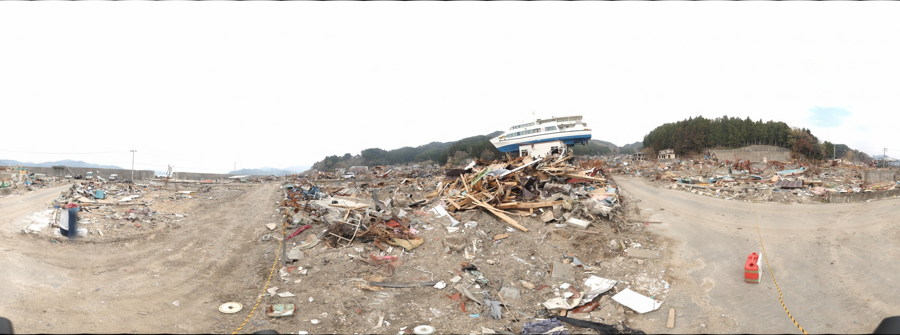

# 岩手県:大槌町:赤浜:観光船はまゆり(5/1)

GigaPan.com で公開されていたギガピクセルパノラマ（GigaPan ID: 76564）のアーカイブです。公開 API・ページ・KML・タイル画像を [GigaPan Salvager](https://github.com/mapconcierge/GigaPanSalvager) で取得・検証し、`docs/` を GitHub Pages として公開できる形で保存しています。



- 元ページ: <https://gigapan.com/gigapans/76564>
- ビューア: <https://mapconcierge.github.io/gigapan_76564/>（このリポジトリ内: [`docs/index.html`](docs/index.html)）
- Google Earth 用 KML: <https://mapconcierge.github.io/gigapan_76564/gigapan_76564.kml>

## パノラマの概要

| 項目 | 内容 |
| --- | --- |
| タイトル | 岩手県:大槌町:赤浜:観光船はまゆり(5/1) |
| ライセンス表記 | CC-by-SA 2.1 by Taichi（説明文の記載） |
| 撮影日時 | 2011-05-01 00:00 (UTC-0400) |
| GigaPan 登録日時 | 2011-05-04 15:24 (UTC-0400) |
| 最終更新 | 2018-07-21 00:31 (UTC-0400) |
| 公開状態 | 公開（`is_private: false`） |
| 閲覧数 | 10,498 回（取得時点） |
| Explore score | 17.0 |
| スナップショット | 12 件（[下記](#スナップショット)） |

### 説明（原文）

> Japan Earthquake in Ohtsuchi
>
> We take some other photos using by UAV
> http://twitpic.com/4td1kn
>
> -----
> Photo by Taichi FURUHASHI ( The Univ. of Tokyo / MAPconcierge Inc, / OpenStreetMap Foundation Japan / sinsai.info )
> License: CC-by-SA 2.1 by Taichi
>
> マップコンシェルジュ株式会社 「GigaPanチーム」撮影
> GigaPan team, MAPconcierge Inc,
> http://gpsconcierge.jp
> http://mapconciege.jp

## 画像の仕様

| 項目 | 内容 |
| --- | --- |
| サイズ | 39,488 × 14,732 px（約 582 メガピクセル） |
| 画角 | 水平 360°、垂直 134.307°（上 +70.0° / 下 -64.3°） |
| タイル | 256 px 角 JPEG、9 レベル、総数 12,053 枚 |
| 形状 | 全周（球面）パノラマ |

## 撮影位置

座標系は WGS84（EPSG:4326）です。

| 項目 | 内容 |
| --- | --- |
| 緯度・経度 | 39.353530, 141.932421 |
| 高度 | 6 m |
| 向き（heading） | 0° |
| 傾き（tilt） | 90° |
| 地図 | [OpenStreetMap](https://www.openstreetmap.org/?mlat=39.353530&mlon=141.932421#map=16/39.353530/141.932421) |

## 撮影・合成情報

GigaPan Stitch が記録した合成時の情報（`stitcher_notes` 原文）です。

```text
GigaPan Stitch version 1.0.0804 (Macintosh)
Panorama size: 581 megapixels (39488 x 14732 pixels)
Input images: 242 (22 columns by 11 rows)
Field of view:  360.0 degrees wide by 134.3 degrees high (top=70.0, bottom=-64.3)
Settings:
  All default settings
Original image properties:
  Camera make: OLYMPUS IMAGING CORP.  
  Camera model: E-P1            
  Image size: 2560x1920 (4.9 megapixels)
  Capture time: 2011-05-01 13:23:17 - 2011-05-01 13:37:31
  Aperture: f/16
  Exposure time: 0.0333333
  ISO: 100
  Focal length (35mm equiv.): unknown
  Digital zoom: off
  White balance: Fixed
  Exposure mode: Manual
Horizontal overlap: 27.3 to 74.5 percent
Vertical overlap: 30.9 to 34.8 percent
Computer stats: 3840 MB RAM, 2 CPUs
Total time 1:12:48 (18 seconds per picture)
  Alignment: 12:58, Projection: 4:32, Blending: 55:18
(Preview finished in 36:43)
```

## スナップショット

パノラマ内の注目箇所です。範囲は全体画像上のピクセル座標です。

| 名前 | 説明 | 作成日時 | 閲覧数 | 範囲 (x / y) |
| --- | --- | --- | --- | --- |
| Found it | . | 2012-05-23 16:14 (UTC-0400) | 303 | x 36,066〜36,337 / y 8,551〜8,731 |
| Nature | . | 2012-05-23 16:13 (UTC-0400) | 238 | x 38,270〜38,647 / y 8,112〜8,363 |
| its not broke | wonder if it floated to its rest | 2012-01-15 20:32 (UTC-0500) | 304 | x 21,394〜22,782 / y 6,486〜7,412 |
| treads | boot | 2012-01-15 20:30 (UTC-0500) | 304 | x 14,561〜14,830 / y 8,796〜8,976 |
| Tsunami nagevolg | Japan | 2011-12-15 11:50 (UTC-0500) | 322 | x 9,562〜29,895 / y 588〜14,143 |
| Motorcycle | A bike that looks to have survived the earthquake | 2011-12-09 17:01 (UTC-0500) | 262 | x 5,249〜6,039 / y 7,743〜8,270 |
| Boat | A random boat | 2011-12-09 17:00 (UTC-0500) | 281 | x 14,678〜15,181 / y 7,440〜7,776 |
| Little Japanese man after the earthquake | Man looking around at all of the garbage from the earthquake | 2011-12-09 16:59 (UTC-0500) | 270 | x 4,838〜5,183 / y 7,725〜7,955 |
| Earthquake | Earthquake in Japan | 2011-12-09 16:32 (UTC-0500) | 251 | x 3,902〜14,654 / y 3,346〜10,514 |
| 人 | 休憩中でしょうか。 | 2011-06-28 22:34 (UTC-0400) | 287 | x 3,627〜4,236 / y 7,518〜7,924 |
| 打ち揚げられた船舶 | ・・・ | 2011-06-28 22:28 (UTC-0400) | 307 | x 19,191〜29,357 / y 3,572〜10,349 |
| Boat on a house（デフォルト） | shows the height of the tsunami | 2011-05-04 16:49 (UTC-0400) | 425 | x 21,765〜25,762 / y 4,713〜7,377 |

## 関連パノラマ

GigaPan ページに表示されていた関連作品（[`page_config.json`](docs/metadata/page_config.json) に 19 件）です。

- [Massif du Mont Blanc（135027）](https://gigapan.com/gigapans/135027)
- [Final Women's 400m Freestyle \| Mundial de Natación Barcelona 2013（135956）](https://gigapan.com/gigapans/135956)
- [MT BOGONG VICTORIA B（111853）](https://gigapan.com/gigapans/111853)
- [Alabama Hils and the Sierra Nevada Range（123733）](https://gigapan.com/gigapans/123733)
- [Stadhuis Hilversum（136344）](https://gigapan.com/gigapans/136344)
- [MSL Curiosity @Shaler ~ Sol 313-316（136084）](https://gigapan.com/gigapans/136084)
- [Long Valley（51932）](https://gigapan.com/gigapans/51932)
- [Huntington Beach, CA 1/12/2012（97338）](https://gigapan.com/gigapans/97338)
- [Salisbury（111532）](https://gigapan.com/gigapans/111532)
- [Panamint Valley and Panamint Range - 360 Panorama（96331）](https://gigapan.com/gigapans/96331)
- [The city center of Warsaw - Palace of Culture and Science 2012 / Centrum Warszawy- Pałac Kultury i Nauki 2012（122606）](https://gigapan.com/gigapans/122606)
- [Roadcut near Packwood, Washington（31961）](https://gigapan.com/gigapans/31961)
- [Mesquite Sand Dunes - 360 VR Panorama（96841）](https://gigapan.com/gigapans/96841)
- [Haleakala 1（120632）](https://gigapan.com/gigapans/120632)
- [Tadoussac Ferry, Saguenay Fjord, Quebec（136571）](https://gigapan.com/gigapans/136571)
- [Pescadero Marsh（51471）](https://gigapan.com/gigapans/51471)
- [ART ON THE YARRA MELBOURNE（122709）](https://gigapan.com/gigapans/122709)
- [Kansas Rainbow（32927）](https://gigapan.com/gigapans/32927)
- [Trona Pinnacles 360（104013）](https://gigapan.com/gigapans/104013)

## アーカイブの取得結果

2026-10-22 に取得・検証した結果です（[`job-result.json`](job-result.json)、[`docs/audit.json`](docs/audit.json)）。

| 項目 | 内容 |
| --- | --- |
| ステータス | complete — 全タイル検証済み（終了コード 0） |
| タイル | 期待 12,053 枚 / 検証済み 12,053 枚 / 欠落 0 枚 |
| タイル容量 | 約 191.6 MB（191,550,480 bytes） |
| 所要時間 | 約 3 分 48 秒 |
| 取得ツール | GigaPan Salvager v0.9.0 |

注意点:

- 公開 JSON に壊れた UTF-8 が含まれています。原本と文字置換した正規化版を保存しました。

## GitHub Pages で公開する

`docs/` がそのまま公開サイトです。KML のタイル参照は公開 URL <https://mapconcierge.github.io/gigapan_76564/> を前提にした絶対パスです。

1. GitHub に `gigapan_76564` という名前のリポジトリを作り、このフォルダを push します。
2. Settings → Pages → Build and deployment で **Deploy from a branch**、ブランチ `main`、フォルダ **`/docs`** を選びます。
3. 数分後に <https://mapconcierge.github.io/gigapan_76564/> でビューア、<https://mapconcierge.github.io/gigapan_76564/gigapan_76564.kml> で Google Earth 用 KML が開けます。

`tiles/` と `ge_tiles/` は同じ画像です（Git では同一内容として1回だけ保存されます）。GitHub Pages の公開サイトは 1 GB までです。

## ディレクトリ構成

| パス | 内容 |
| --- | --- |
| [`docs/`](docs/) | 公開用ファイル一式（GitHub Pages の公開フォルダ） |
| `docs/index.html` / `docs/viewer.html` | 外部ライブラリ不要のブラウザ用ビューア（同じ内容） |
| `docs/preview.jpg` | 完全に取得できた低解像度層のプレビュー |
| `docs/tiles/` | 配信元の四分木構造のままのタイル JPEG |
| `docs/ge_tiles/` | Google Earth 用の `level/y/x.jpg` 構造（`tiles/` と同じ画像） |
| `docs/gigapan_76564.kml` | Google Earth 用 KML（タイル参照は公開 URL の絶対パス） |
| `docs/gigapan_76564_local.kml` | 同じ KML のローカル版（`ge_tiles/` を相対参照。展開したフォルダで使用） |
| `docs/thumbnails/` | パノラマ・スナップショットの公開サムネイル（取得できた場合） |
| `docs/tile_manifest.csv` | 全タイルの座標・取得 URL・バイト数・SHA-256・検証結果 |
| `docs/audit.json` / `docs/missing_tiles.json` / `docs/plan.json` | 検証結果・欠落タイル・画像寸法 |
| `docs/metadata/` | 取得した元メタデータ（下表） |
| `job-result.json` | 取得ジョブの結果 |

### `docs/metadata/` の内容

| ファイル | 内容 | 取得元 |
| --- | --- | --- |
| [`gigapan.json`](docs/metadata/gigapan.json) | パノラマ本体の情報（原本） | `gigapan.com/gigapans/76564.json` |
| [`normalized.json`](docs/metadata/normalized.json) | 上記の正規化版（文字化けの置換・寸法の補完） | 加工 |
| [`page.html`](docs/metadata/page.html) | GigaPan ページの HTML（書き換えなし） | `gigapan.com/gigapans/76564` |
| [`page_config.json`](docs/metadata/page_config.json) | ビューア設定（寸法・タイル配信元・関連パノラマ） | `page.html` から抽出 |
| [`retrieval_log.json`](docs/metadata/retrieval_log.json) | 取得日時・URL・ETag・エラーの記録 | — |
| [`snapshot_212212_comments_1.html`](docs/metadata/snapshot_212212_comments_1.html) | スナップショットのコメント（HTML） | `gigapan.com/gigapans/show_snapshot_comments/ID` |
| [`snapshots_normalized.json`](docs/metadata/snapshots_normalized.json) | スナップショット一覧の正規化版 | 加工 |
| [`snapshots_page_1.json`](docs/metadata/snapshots_page_1.json) | スナップショット一覧（原本） | `.../snapshots.json?page=N&per_page=100` |
| [`source.kml`](docs/metadata/source.kml) | Google Earth 用 PhotoOverlay の原本 | `gigapan.com/gigapans/76564.kml` または `--kml` |

## 権利・出典

- 元データ: [GigaPan 76564](https://gigapan.com/gigapans/76564)
- 写真・説明・コメントの権利は各著作者に帰属します。利用条件は上記の説明文・元ページの表記に従ってください（このアーカイブで独自のライセンスを付与するものではありません）。
- 元の撮影素材・非公開画像・アカウント限定の内容は含みません。`metadata/page.html` は原本のまま保存しているため外部サイトを参照します。

---

Generated by [GigaPan Salvager](https://github.com/mapconcierge/GigaPanSalvager) v0.9.0.
